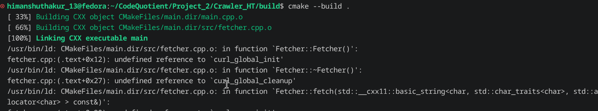
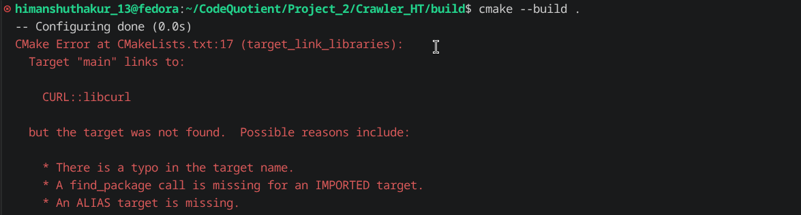
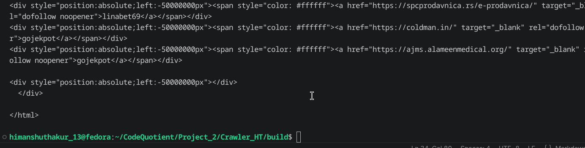

# Build Log

## Date: 18/07/2026

### Session - 1

### Work Completed
- Completed the basic design proposal for the **Web Crawler**.
- Created the basic project structure with `include` and `src` folders.
- Wrote the header file for the `WebCrawler` class which is going to act as the blueprint for the crawler object.
- Started working on the **Frontier** implementation.

In the design proposal I had decided to create a separate `Frontier` class which was going to be a wrapper around the `LinkedList` and behave like a FIFO queue. While implementing it, I realized that I decided to implement a `Queue` data structure in my data structure library which internally uses a `LinkedList`.

Instead of creating another wrapper, I decided to directly use my `Queue` implementation. The `Queue` class already exposes operations like `push()`, `pop()`, `size()` and `empty()` while keeping the `LinkedList` object private.

While implementing the queue, I also learned about the **Rule of Zero**. Since the class only contains members that manage their own resources, I do not need to explicitly implement the destructor, copy constructor or copy assignment operator. The compiler-generated special member functions are sufficient.

---

### Session - 2

### Work Completed
- Started learning about the **Fetcher** component.
- Learned the difference between **Static** and **Dynamic** web pages.
- Decided that the first version of the crawler will only support **Static HTML pages**.
- Started learning **libcurl** and its Easy Interface.
- Implemented a basic program that downloads the HTML of a webpage and stores it inside a `std::string`.

### Problems Faced
I did not know how libcurl returns the downloaded HTML to the program. I was confused about the purpose of `CURLOPT_WRITEFUNCTION`, `CURLOPT_WRITEDATA` and the callback function.

### Solution
After understanding the callback mechanism, I learned that libcurl sends the downloaded data to the callback function in small chunks. The callback receives a pointer to the downloaded bytes and appends them to a `std::string`. The `CURLOPT_WRITEDATA` option is used to pass the address of the string to the callback through the `userdata` parameter.

I also learned the basic workflow of the Easy Interface:

- Create a handle using `curl_easy_init()`.
- Configure the handle using `curl_easy_setopt()`.
- Perform the request using `curl_easy_perform()`.
- Release the handle using `curl_easy_cleanup()`.

---
### Session - 3

### Work Completed
- Started implementing the `Fetcher` class.
- Created `fetcher.h` and `fetcher.cpp`.
- Moved the libcurl implementation inside the `Fetcher` class to hide the implementation details from the rest of the project.
- Wrote a simple program in `main.cpp` to test the fetcher.
- Configured the project using **CMake**.

### Problems Faced
While compiling the project, CMake reported a linker error because it could not find the implementation of the libcurl functions even though the header file was included.



### Solution
The problem was that the executable was not linked against the libcurl library. I added the following line to `CMakeLists.txt`:

```cmake
target_link_libraries(main PRIVATE CURL::libcurl)
```

After that I encountered another error.



This happened because `find_package(CURL REQUIRED)` was missing before `target_link_libraries()`.

I added the following line:

```cmake
find_package(CURL REQUIRED)
```

After fixing both issues, the project compiled successfully.

I tested the fetcher and was able to download the HTML of a webpage and store it inside a `std::string`.

