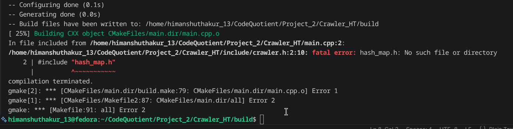
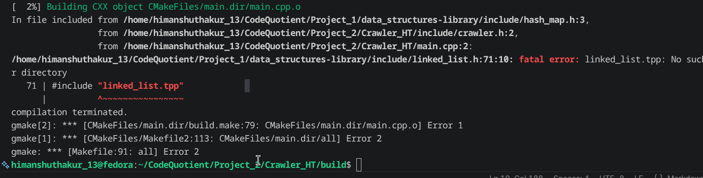
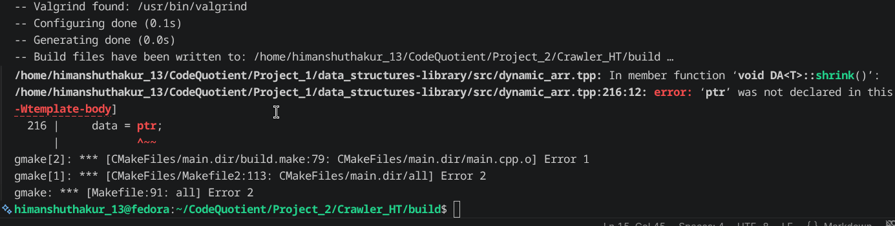
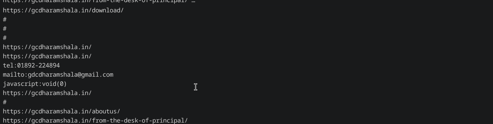
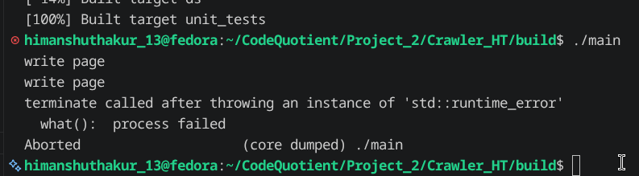

# Build Log

## Date: 20/07/2026

### Session - 1

### Work Completed
- Started working on the URL extraction logic from the HTML page returned by the `fetch()` function.
- Created a private function `link_extractor()` inside the `WebCrawler` class.
- Decided that the function will return a `DynamicArray` of URLs extracted from the HTML page.
- Wrote a temporary URL extraction logic using a simple hardcoded approach.
- Successfully extracted everything after `<a href=` until the closing `>` as an initial implementation.

### Problems Faced
While testing the `link_extractor()` function, I created a `WebCrawler` object in `main.cpp`. During compilation I realized that my data structure library was not included in the project.



### Solution
I decided to add my **Data Structure Library** as a subdirectory inside the WebCrawler project. I made the required changes in both `CMakeLists.txt` files.

After that I encountered another issue.



The compiler was unable to find `linked_list.tpp` which is included by the `HashMap` implementation. The problem was that the `src` directory of the data structure library was not added as an include directory for the interface library.

I fixed the issue by modifying the `CMakeLists.txt` of the Data Structure Library and adding the `src` directory as an include directory.

---

## Date: 21/07/2026

### Session - 2

### Work Completed
- Continued testing the URL extraction logic.
- Fixed a bug in the Data Structure Library.
- Successfully made the temporary URL extraction logic work.

### Problems Faced
During compilation I encountered another error.



The error was inside the `DynamicArray` shrink function.

### Solution
The problem was that I declared a pointer inside an `if` block but later used it outside the block.

I moved the declaration outside the `if` block and initialized it with `nullptr`.

After fixing the issue, the temporary URL extraction logic started working.

---

## Date: 21/07/2026

### Session - 3

### Work Completed
- Continued improving the URL extraction logic.
- Changed the extraction approach to search for `href` instead of directly searching for `"https"`.
- Learned how to use escaped single quotes (`'\''`) in character literals.
- Implemented a cleaner URL extraction algorithm.

### Problems Faced
After modifying the extraction logic, nothing was being printed.

### Solution
To understand the issue, I analyzed the logic.

The program first searches for:

```html
<a 
```

After finding it, the pointer is incremented by three characters. Then another loop searches for `"https"`.

Initially I wrote the loop like this:

```cpp
while(html[i] != 'h' && html[i+1] != 't' &&
      html[i+2] != 't' && html[i+3] != 'p' &&
      html[i+4] != 's')
{
    i++;
}
```

This was incorrect because the loop stopped as soon as any one of the comparisons became false.

I replaced it with:

```cpp
while(html[i] != 'h' || html[i+1] != 't' ||
      html[i+2] != 't' || html[i+3] != 'p' ||
      html[i+4] != 's')
{
    i++;
}
```

Now the loop continues until the sequence `"https"` is found.

Later I realized there was an even better approach.

Instead of searching for `"https"`, I decided to search for `"href"`.

The new logic works as follows:

- Find `<a `
- Move the pointer after `<a `
- Search for `href`
- Skip characters until either `"` or `'` is found
- Store that character as the starting delimiter
- Copy every character until the same delimiter is found again
- Store the extracted URL inside the array
- Return the array at the end of the function

While implementing this, I also learned that to represent a single quote character in C++ I need to write it as:

```cpp
'\''
```

---

### Problems Faced
After implementing the new logic, it still returned no output.

### Solution
The problem was simply a typo. I accidentally wrote `!=` instead of `==`.

After correcting the condition, the function started returning URLs.

The output looked like this:



The extractor was returning not only normal URLs but also values like:

- `#`
- `tel:`
- `mailto:`
- `https:`
- `http:`
- `javascript:void(0)`

The next step is to normalize these URLs before adding them to the crawler.

---

## Date: 21/07/2026

### Session - 4

### Work Completed
- Started integrating the crawler with the fetcher.
- Implemented a basic version of the `crawl()` function.
- Started saving the downloaded HTML pages into files.

### Problems Faced
The project failed to build because my generic `Queue` implementation was missing:

```cpp
#include "queue.tpp"
```

at the end of `queue.h`.

### Solution
I added the missing include statement and rebuilt the project successfully.

During execution another error occurred.



The `Fetcher` was throwing an exception because `curl_easy_perform()` was not returning `CURLE_OK`.

Based on my understanding, the extracted URLs were not yet normalized, causing invalid URLs to be passed to the fetcher.

I had already implemented exception handling inside the `Fetcher`, so my next step is to add a `try`/`catch` block around the fetch operation inside the crawler.

I also noticed that the downloaded pages were not appearing where I expected.

The reason was that the program created the `pages` folder inside the **build** directory because the executable runs from there.

---

## Date: 21/07/2026

### Session - 5

### Work Completed
- Started designing the URL normalization component.
- Decided to first split a URL into its individual components.
- Implemented logic to extract:
  - Scheme
  - Host
  - Port
  - Path
  - Query
  - Fragment

### Design Decision
While working on the normalization logic, I realized that it would become fairly complex.

Instead of keeping everything inside `WebCrawler`, I decided to create a separate file named `url_handler`.

Inside it I created a `URL` class responsible for:

- Breaking a URL into its components.
- Resolving relative URLs into absolute URLs.
- Ignoring URLs that are not valid web pages.
- Normalizing URLs.

The logic that parses a URL into its individual components has been moved into the constructor of the `URL` class, and these components are stored as private data members.