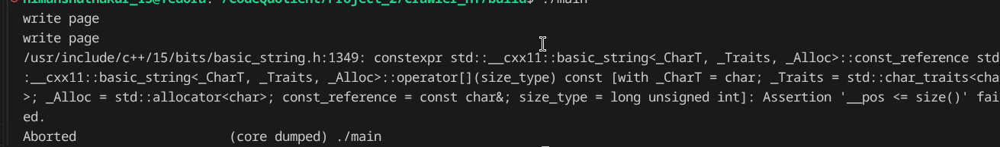
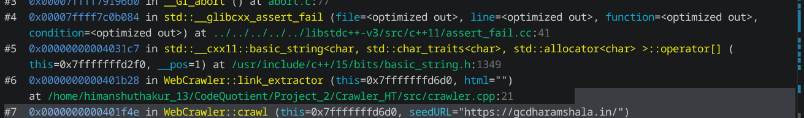

# Build Log

## Date: 21/07/2026

### Session - 1

### Work Completed
- Resumed working on the `url_handler` module.
- Refactored the URL parsing logic by moving it into a separate `split_url()` function instead of performing all parsing inside the constructor.
- Modified the constructor so that it simply calls `split_url()`, making the class cleaner and separating object initialization from parsing logic.

- Implemented the `resolve_url()` function.
- The function accepts:
  - Base URL
  - URL to be resolved

- Added support for four different cases:
  - **Absolute URL** → Return it directly.
  - **Protocol-relative URL** (`//example.com`) → Add the protocol from the base URL.
  - **Root-relative URL** (`/contact`) → Append it after the host of the base URL.
  - **Relative URL** (`contact`, `../contact`) → Resolve it relative to the base path.

- Started integrating the resolver into the `crawl()` function.

### Design Decision
While integrating the resolver, I noticed that whenever a URL is popped from the frontier, I should immediately create a `URL` object from it.

This object naturally becomes the **base URL** for every link extracted from that page. Since all of its components are already parsed, comparing the host, scheme, and path inside the resolver becomes much simpler.

After making these changes, I integrated `resolve_url()` into the crawler and verified that it was working correctly.

---

## Date: 21/07/2026

### Session - 2

### Work Completed
- Started implementing the URL normalization logic.
- Created a temporary `URL` object from the URL returned by the resolver.
- Added normalization steps:
  - Ensure the path is never empty (default to `/`).
  - Convert the scheme to lowercase.
  - Convert the host to lowercase.
  - Remove URL fragments (`#fragment`).
  - Resolve `.` and `..` path components.
  - Remove default ports (`80` for HTTP and `443` for HTTPS).

- Integrated the URL normalizer into the `crawl()` function.

### Problems Faced
After integrating the normalizer, the crawler started crashing.

The important part of the error was:

```
operator[](size_type)
```

from `basic_string.h`, along with

```
_pos <= size() failed
```

This indicated that somewhere I was accessing a character outside the bounds of a `std::string`.



---

### Investigation

My first suspicion was the `link_extractor()` function because I had recently modified one of the loop conditions.

Initially, I thought this loop was the problem:

```cpp
for (int i = 0; i < html.size() - 7; ++i)
```

However, after checking the logic carefully, I realized that this alone should not access memory beyond `html.size() - 1`, so it was probably not the actual cause.

Next, I suspected the `split_url()` function where I access `url[i]` while parsing the scheme.

After testing it, I encountered the same error again, confirming that the issue was somewhere else.

At this point, I decided to debug the program using **GDB**.

The debugger pointed me to the exact line where the crash occurred.



---

### Solution

After inspecting the variables, I found that the crash happened whenever:

```cpp
html.size() == 0
```

The loop condition was:

```cpp
for (int i = 0; i < html.size() - 6; ++i)
```

The problem is that `html.size()` returns a `size_t` (an unsigned integer).

When the HTML string is empty, `html.size() - 6` does **not** become `-6`; instead, it underflows and becomes a very large positive number.

As a result, the loop executes even though the string is empty, eventually causing an out-of-bounds access.

I fixed the issue by replacing the loop condition with:

```cpp
for (size_t i = 0; i + 6 < html.size(); ++i)
```

This avoids unsigned integer underflow and guarantees that there are enough characters remaining before accessing `html[i + 6]`.

After making this change, the crawler executed successfully without crashing.

### Key Learning
This debugging session reminded me to be careful when working with `size_t`. Expressions like:

```cpp
html.size() - N
```

can easily underflow when the string is shorter than `N`.

A much safer approach is:

```cpp
i + N < html.size()
```

which prevents unsigned underflow and avoids out-of-bounds accesses.