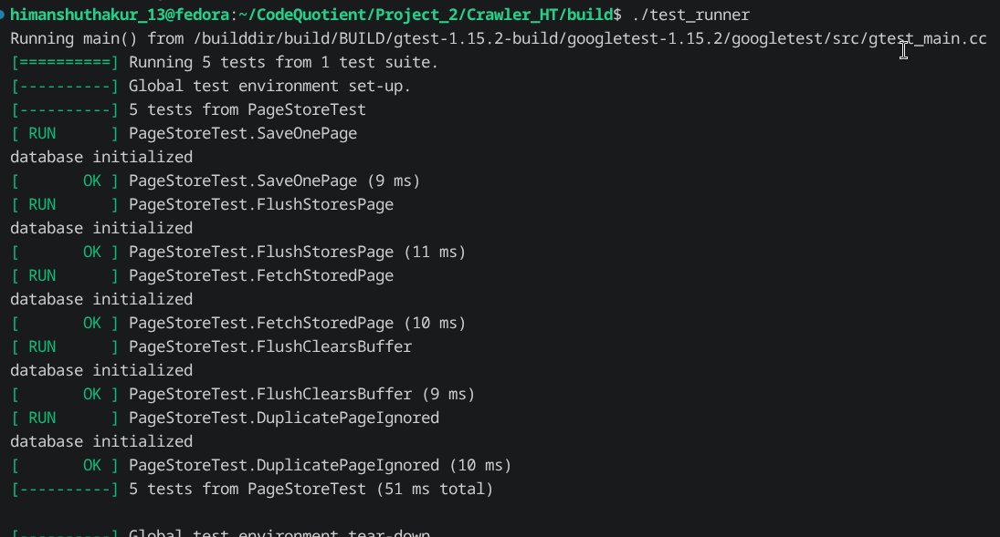

# Build Log

## Date: 23/07/2026

### Session - 1

### Work Completed

- While testing the crawler multiple times, I found a bug where the crawler would fail on the second execution.
- The issue was caused by the `PageLoader` always assigning page IDs starting from `0`. During the second run, the crawler attempted to insert pages with the same IDs that already existed in the SQLite database, causing a primary key conflict during the `flush()` operation.


- Initially, I modified the `PageStore::save()` function so that pages already present in the database were not added to the page buffer again.
- Although this prevented duplicate pages from being buffered, it did not solve the crash because newly created `Page` objects were still being assigned IDs starting from `0` on every execution.

- After analyzing the problem, I decided that page IDs should not be managed by the crawler at all.
- I changed the database design to let SQLite generate page IDs automatically using an `INTEGER PRIMARY KEY AUTOINCREMENT`.
- To support this change, I modified the `insert()` function inside `sqlite_db.cpp` so that it no longer inserts the page ID and only stores the URL and HTML content.

### Debugging

- While retesting the new implementation after recreating the database, the crawler failed even on the first run.
- After debugging, I found that the SQL insert statement was still using the old parameter indices (`2` and `3`) for the URL and HTML values.
- I corrected the parameter bindings and reran the tests.

### Result

- The crawler now runs successfully multiple times.
- Existing pages are no longer inserted again.
- SQLite automatically generates unique page IDs for newly discovered pages.


---

## Session - 2

### Work Completed

- While further testing, I noticed another inefficiency in the crawler.
- Even if a page already existed in the database, the crawler was still downloading the page from the web, extracting links, resolving URLs, and normalizing them again.
- Although duplicate pages were no longer stored, this still resulted in unnecessary network requests and processing.

### Optimization

- To eliminate this redundant work, I decided to reuse the HTML already stored inside the database instead of downloading it again.
- I implemented page retrieval logic in the SQLite layer.
- Since the crawler interacts with the database only through `PageStore`, I added two new helper functions inside `PageStore`:
  - `exists()` to check whether a page is already stored.
  - `fetch()` to retrieve the stored page from the database.

### Updated Crawler Flow

```text
Pop URL from Frontier
        │
        ▼
Is page already in database?
        │
   ┌────┴────┐
   │         │
 Yes         No
   │         │
   ▼         ▼
Load HTML   Fetch from Web
from DB        │
   │           ▼
   │      Store Page in Buffer
   │           │
   │           ▼
   │      Extract Links
   │           │
   │      Normalize URLs
   │           │
   └──────────► Process Links
                │
                ▼
          Already Visited?
            ┌────┴────┐
            │         │
           Yes        No
            │         │
            ▼         ▼
           Skip   Push into Frontier

          Flush Buffer
                │
                ▼
         SQLite Database
```

---

## Session - 3

### Testing

- Began testing the complete project after implementing the crawler optimizations.
- Updated the `CMakeLists.txt` configuration before running the unit tests.

### URL Resolver Tests

- Executed all unit tests for the URL resolver.
- All test cases passed successfully.


---

### URL Normalizer Tests

- Ran the URL normalizer test suite.
- One test case failed while handling dot-segment (`.` and `..`) paths.


- Printed the normalized output to identify the issue.

```text
Result = https://example.com/a/..c
```

- Fixed the dot-segment normalization logic.
- Reran the complete test suite.
- All URL normalizer test cases passed successfully.


---

### SQLite Database Tests

- Executed the SQLite database unit tests.
- All test cases passed successfully.


---

### PageStore Tests

- Ran the `PageStore` test suite.
- Verified page buffering, duplicate handling, and database wrapper functionality.
- All test cases passed successfully.



---

## Summary

### Bugs Fixed

- Fixed duplicate page ID issue that prevented the crawler from running multiple times.
- Switched page ID generation to SQLite `AUTOINCREMENT`.
- Corrected SQL parameter binding after modifying the insert query.
- Prevented duplicate pages from being inserted into the database.
- Added the ability to retrieve previously crawled pages directly from the database.
- Eliminated unnecessary page downloads for already stored pages.
- Fixed URL normalizer handling of dot-segment paths.

### Test Results

| Component | Status |
|-----------|--------|
| URL Resolver | ✅ Passed |
| URL Normalizer | ✅ Passed |
| SQLiteDB | ✅ Passed |
| PageStore | ✅ Passed |
| Multiple Crawler Runs | ✅ Passed |