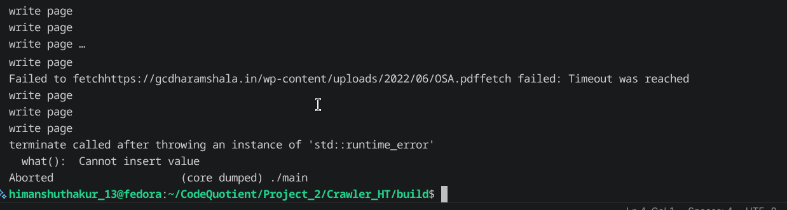
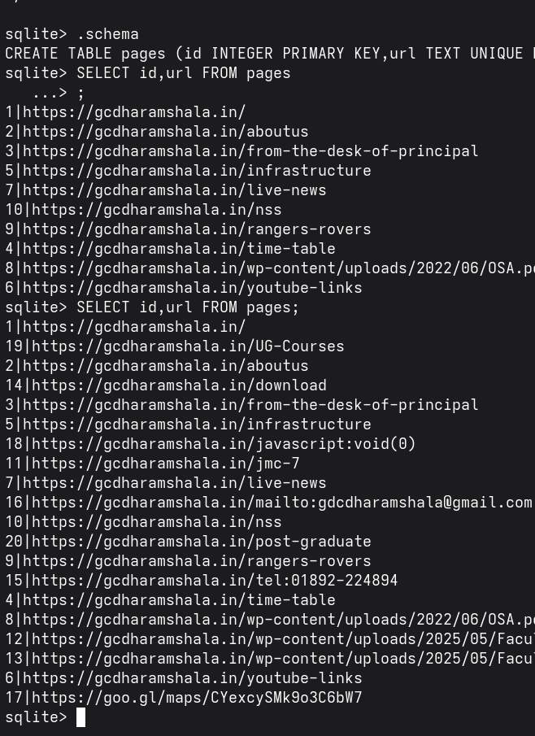
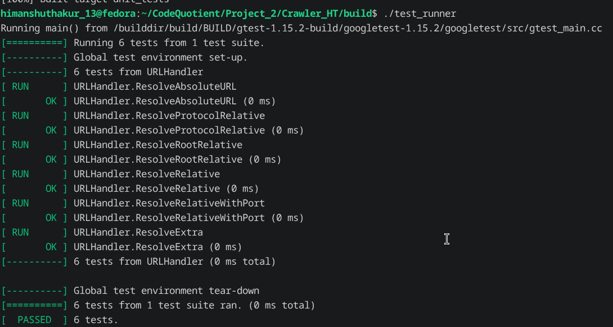
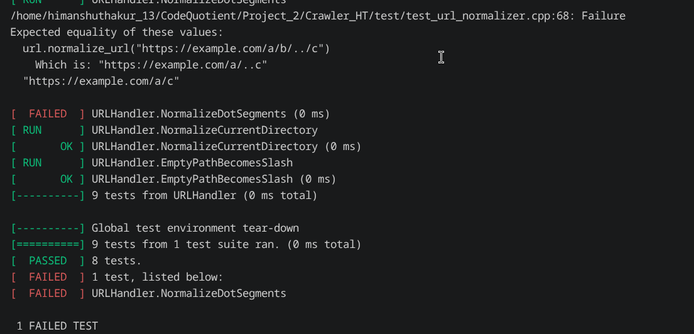
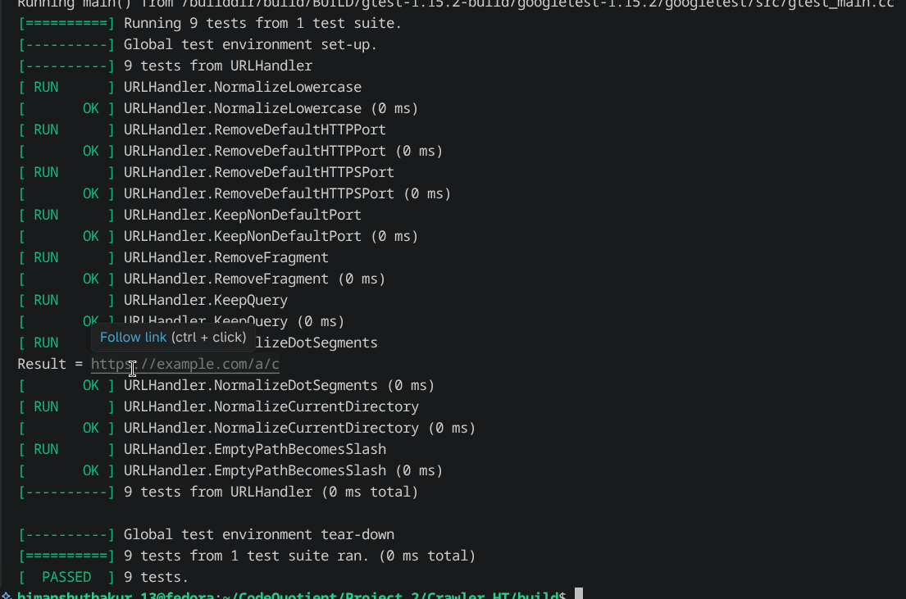

There's bug my crawler will not run on second time It is because when I first run the crawler the pages in the data base are stored with page id which are set by pageloader function which always start with zero
Second time when I will run my crawler it would again try to store the pages from id 0 but since id 0 page already exist in the database it will throw an error and this will happen when the loop would end in the flush function when i try to load the pages into the db which are already there hence it will create a problem 



To solve this 
First I make a change in pagestore save function I am not going to save pages in buffer which are already exist there also one more thing if i again run the webcrawler with the same seed url it should not follow the process again to fetch and extract link if the page is already there in the database right now this do not save that extra fetch and extract computaion but I will think of it next

Even with this fix it does not that crash issue with the same id as in the next run crawler will still create page with id start from zero 

The solution would be not use the id member with page object and store the page with id auto increment by dbms set up by itself as interger primary key 

I need to make change in the insert function of the sqlite_db.cpp and does not insert id of the page 

Now retesting it first delete the old db then run the crawler two times

okay the crawler fails on the first try i need to figure out what was the mistake
The mistake is in the insert function I am using the old index 2,3 for url and html

Okay it start working properly the already loaded page are not saved in the database again and the program can run second time too 


what there is a still a problem if a page is already in database it will not be stored again but the url for it will again be fetched and the links from the page will be again extracted and push into the queue there pages will not be stored inside the buffer but there is going to be extra fetch and extraction resolve and normalization 
To solve this I can do is to fetch the page from the database instead from the web 
i have implemented the fetch logic now going to use in crawl function
Before running since the db is wrapped around page store need to make some change inside that pagestore logic too since i can't access the fetch logic directly 

created two function in page store one to check and one to fetch 

the flow of crawler is now like 
## Updated Crawler Flow

```text
Pop URL from Frontier
        │
        ▼
Is page already in database?
        │
   ┌────┴────┐
   │         │
 Yes         No
   │         │
   ▼         ▼
Load HTML   Fetch from Web
               │
   │           ▼
        Store Page in PageBuffer
from DB        │
   │           ▼
   │        Extract Links
   │           │
   │        Normalize URL     
   │           │
   └──────► Process Links
                │
                ▼
             If Visited
                       
            ┌────┴────┐
            │         │
           Yes        No
            │         │
            ▼         ▼
           Skip   Push into Frontier

        
            Flush Buffer
                │
                ▼
            SQLite Database

--

Now I begin testing of the project 
First I change the CMake file

then i run the first test file for resolve url function it pass all test case 


after it i run the normalizer and it failed one test case for Dot segments like url


To handle this lets print the result 
The result is like this Result = https://example.com/a/..c

Make changes in the normalizer function and rerun
Pass all the test cases 


