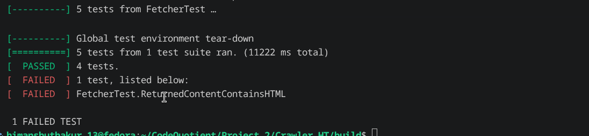
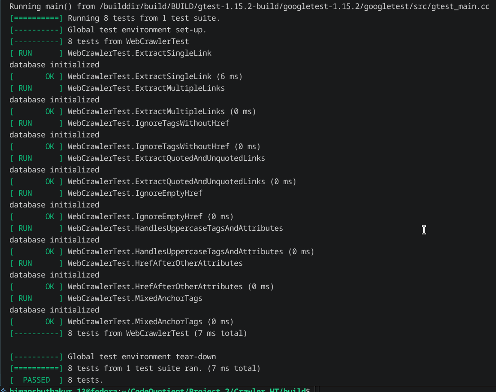
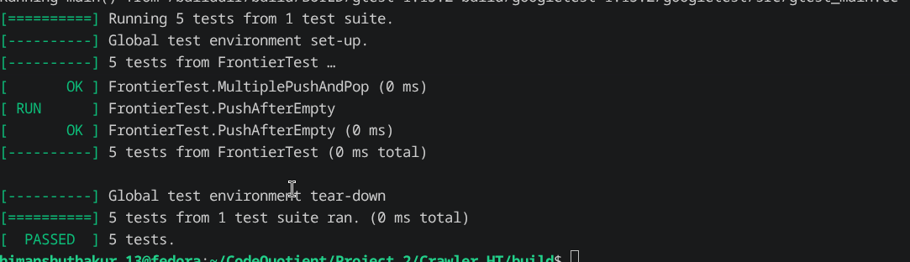
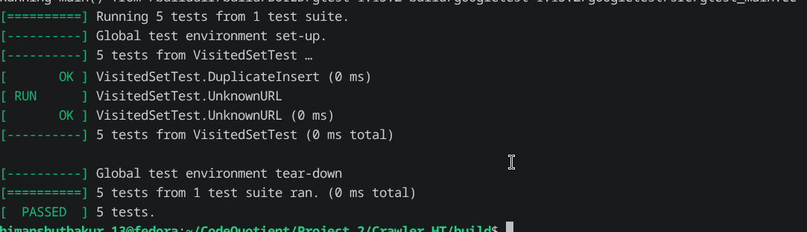

# Build Log

## Date: 24/07/2026

---

## Session - 1

### Work Completed

- Started executing the remaining unit tests after completing the crawler implementation.
- Began with the **Fetcher** test suite.

### Fetcher Tests

- Ran all Fetcher unit tests.
- Most test cases passed successfully.
- One test case failed:

```text
FetcherTest.ReturnedContentContainsHTML
```



### Observation

- The fetcher was able to download the page successfully, but the returned content did not satisfy the expected HTML validation performed by the test.
- Investigated the implementation but could not determine the exact cause at this stage.
- Decided to postpone this issue temporarily and continue testing the remaining project components.

---

## Session - 2

### Extract Links Tests

- Began testing the `extract_links()` function.
- The provided HTML contained multiple types of hyperlinks including relative and absolute URLs.
- Verified that every expected link was extracted correctly.

### Result

- All Extract Links test cases passed successfully.



---

### Frontier Tests

- Executed the Frontier unit tests.
- Verified queue operations including insertion, removal, and traversal.

### Result

- All Frontier test cases passed successfully.



---

### Visited Set Tests

- Ran the Visited Set test suite.
- Verified duplicate detection and lookup functionality.

### Result

- All Visited Set test cases passed successfully.



---

## Session - 3

### Bug Fix - Duplicate Pages Inside Buffer

While testing the complete crawler repeatedly, I encountered another issue.

### Problem

- The `PageStore` buffer could contain multiple copies of the same page.
- During `flush()`, duplicate pages were inserted into SQLite.
- SQLite rejected the duplicate insertion and produced a database insertion error.

### Solution

- Added a `HashMap` inside `PageStore`.
- Before buffering a page, the crawler now checks whether the page already exists inside the current buffer.
- Duplicate pages are ignored before reaching the database layer.

---

### Memory Optimization

While reviewing the design, I noticed another problem.

### Problem

- Pages remain stored inside the in-memory buffer until the crawler finishes.
- Crawling a large number of pages could consume a significant amount of RAM.

### Solution

- Added automatic flushing after every **10 buffered pages**.
- This limits memory usage while still reducing the number of database writes.

---

### SQLite Transaction Optimization

The original implementation inserted each page individually.

```text
Insert Page
↓
Disk Write

Insert Page
↓
Disk Write

Insert Page
↓
Disk Write
```

This caused multiple disk writes and reduced performance.

### Optimization

- Wrapped all page insertions inside a SQLite transaction.

```sql
BEGIN TRANSACTION
    Insert Page 1
    Insert Page 2
    Insert Page 3
COMMIT
```

- Added rollback handling if any insertion fails.
- Multiple inserts are now committed together, significantly reducing disk I/O.

---

## Session - 4

# Indexer Development

### Initial Design

Started implementing the **Indexer** module.

The Indexer is responsible for converting stored HTML pages into a searchable inverted index.

The first stage is HTML parsing.

Its responsibility is to extract only the text visible to the user while ignoring HTML tags.

### Project Structure

Created a separate `indexer` directory inside both:

```text
include/indexer/
src/indexer/
```

to keep the indexing module independent from the crawler implementation.

---

### HTML Parser

Implemented an initial `extract_text()` function inside the `HTMLParser` class.


The parser currently extracts visible text while ignoring HTML tags.

---

### Handling Script and Style Tags

Started extending the parser to ignore:

- `<script>`
- `<style>`

because their contents should not be indexed.

---

### Refactoring Parser State

Initially the parser used boolean flags to represent its current state.

I replaced them with an `enum class`.

```cpp
enum class ParserState
{
    TEXT,
    TAG,
    SCRIPT,
    STYLE,
};
```

This is equivalent to

```cpp
TEXT = 0
TAG = 1
SCRIPT = 2
STYLE = 3
```

Using named states makes the code much easier to understand.

Instead of

```cpp
if(state == 1)
```

the parser now uses

```cpp
if(state == ParserState::TAG)
```

which clearly expresses the intent.

The parser state transitions are implemented using a `switch` statement.

---

### Comment Handling

Added support for HTML comments.

The parser now detects comment blocks and switches into a comment state until the closing marker is found.

### Current Limitation

The parser still does not handle uppercase tags such as

```html
<SCRIPT>
```

This will be addressed in a future update.

---

## Session - 5

### Tokenizer

Implemented the Tokenizer.

The tokenizer converts plain text into individual words that can later be indexed.

The implementation was tested successfully.

---

### Normalizer

Started implementing the Normalizer.

A complete normalizer performs many operations such as punctuation removal, stemming, and stop-word removal.

For the initial version, only **lowercasing** has been implemented.

---

### Posting Structure

Implemented the `Posting` structure.

The Posting is the smallest unit stored inside the inverted index.

Currently it stores only

```cpp
page_id
```

The page ID is obtained from the SQLite database.

---

### Posting List

Implemented the `PostingList` class.

Each posting list internally contains a `DynamicArray<Posting>` representing every page that contains a given word.

---

### Inverted Index

Implemented `inverted_index.h`.

The inverted index internally uses the custom `HashMap`.

While implementing the search operations, I discovered that several data structure improvements were necessary.

### Changes Made to Data Structures

#### HashMap

- Marked `contains()` as a `const` member function.
- Added a `const` overload of `find()` returning

```cpp
const V*
```

instead of

```cpp
V*
```

This allows searching through constant objects without modifying the map.

#### LinkedList

Since `HashMap::find()` internally uses `LinkedList::find()`, a corresponding `const` overload was also added to the linked list implementation.

---

### Indexer Workflow

Implemented both  

- `indexer.h`
- `indexer.cpp`

The complete indexing pipeline is now connected.

```text
Page
    │
    ▼
HTMLParser
    │
    ▼
Plain Text
    │
    ▼
Tokenizer
    │
    ▼
DA<string>
    │
    ▼
Normalizer
    │
    ▼
InvertedIndex
    │
    ▼
HashMap
    │
    ▼
PostingList
    │
    ▼
Posting
```

---

## Session - 6

### Crawler Refactoring

While integrating the Indexer with the crawler, I noticed that `PageStore::pages_saved()` returned only the number of pages currently stored in the in-memory buffer instead of the total number of pages stored in the database.

### Changes Made

- Renamed `pages_saved()` to `buffered_pages()` to better reflect its purpose.
- Added a new function that returns the total number of pages stored in the database.

---

### Processed Page Counter

Added a new data member:

```cpp
processed_pages
```

inside the `WebCrawler` class.

This counter tracks the total number of processed pages independently of the buffer size.

---

### Crawler Pipeline Refactoring

Refactored the crawler workflow to simplify page processing.

```text
Frontier
    │
    ▼
Pop URL
    │
    ▼
Check Cache
    │
 ┌──┴────────┐
 │           │
 ▼           ▼
SQLite    Network
 │           │
 └────┬──────┘
      ▼
 Build Page
      │
 ┌────┴─────┐
 ▼          ▼
Save      Extract Links
(if new)
      │
      ▼
Resolve URLs
      │
      ▼
Visited Check
      │
      ▼
Push to Frontier
      │
      ▼
processed_pages++
```

---

# Summary

## Features Added

- Completed Extract Links tests.
- Completed Frontier tests.
- Completed Visited Set tests.
- Added duplicate-page detection inside `PageStore`.
- Added automatic buffer flushing after every 10 pages.
- Optimized SQLite writes using transactions.
- Created the complete Indexer module structure.
- Implemented HTML Parser.
- Implemented Tokenizer.
- Implemented Normalizer (lowercasing).
- Implemented Posting and PostingList.
- Implemented Inverted Index.
- Integrated the full indexing workflow.
- Refactored crawler processing pipeline.
- Added processed page counter.
- Improved `HashMap` and `LinkedList` const-correctness.

## Remaining Work

- Investigate and fix the failing Fetcher test (`FetcherTest.ReturnedContentContainsHTML`).
- Add support for uppercase HTML tags in the HTML parser.
- Extend the Normalizer with additional text normalization features.
- Implement indexing tests and search functionality.