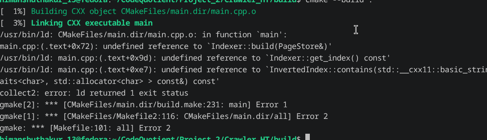
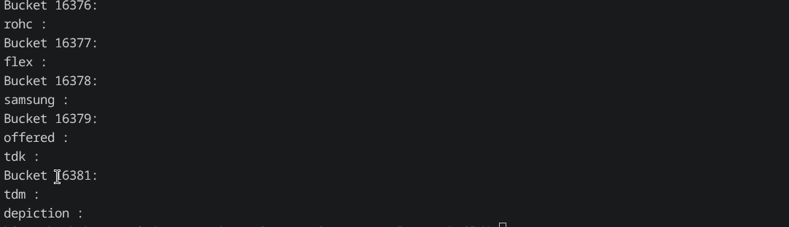

# Build Log

## Date: 27/07/2026

---

## Session - 1

### Work Completed

Started integrating the **Indexer** with the crawler by allowing it to read all previously crawled pages from the database.

### Implementing `get_all_pages()`

- Added a new `get_all_pages()` function inside `PageStore`.
- The function internally calls the SQLite database layer to retrieve every stored page.
- It returns a `DynamicArray<Page>` containing all pages present in the database.

### Building the Index

- Implemented the `build()` function inside `indexer.cpp`.
- The function first retrieves all pages using `PageStore::get_all_pages()`.
- It then iterates through the returned array and calls `index_page()` for every page.

### Current Workflow

```text
SQLite Database
        │
        ▼
PageStore::get_all_pages()
        │
        ▼
DynamicArray<Page>
        │
        ▼
for each page
        │
        ▼
index_page(page)
```

---

## Session - 2

### Implementing `index_page()`

Implemented the core indexing workflow.

For every page:

- Read the page HTML.
- Pass the HTML to the `HTMLParser`.
- Extract visible text.
- Tokenize the extracted text.
- Normalize every token.
- Store each normalized word inside the inverted index.

The complete indexing pipeline is now:

```text
Page
   │
   ▼
HTML
   │
   ▼
HTMLParser::extract_text()
   │
   ▼
Plain Text
   │
   ▼
Tokenizer
   │
   ▼
Tokens
   │
   ▼
Normalizer
   │
   ▼
InvertedIndex::add_word()
```

---

### Implementing `add_word()`

The `add_word()` function of the inverted index internally relies on the custom `HashMap`.

It works by calling:

```cpp
index.get(word)
```

The behavior of `HashMap::get()` is:

- If the key already exists, it returns a reference to the associated value.
- If the key does not exist, it inserts a new key-value pair and returns a reference to the newly created value.

The key-value pair stored inside the hash map is:

```text
keyword
    │
    ▼
PostingList
```

Each `PostingList` contains a `DynamicArray<Posting>`.

Each `Posting` currently stores only the page identifier.

The insertion process becomes:

```cpp
index.get(word).add_posting(page_id);
```

This automatically creates a new posting list for new words while appending page IDs for existing words.

---

### Future Observation

While reviewing the implementation, I noticed a potential issue.

If `Indexer::build()` is called multiple times without clearing the index first, duplicate postings may be inserted into the posting lists.

Although duplicate keys inside the `HashMap` simply overwrite the existing value, duplicate postings inside each `PostingList` still need to be investigated in the future.

---

## Session - 3

### Exposing the Inverted Index

Since `InvertedIndex` is a private member of the `Indexer` class, it cannot be accessed directly.

To allow read-only access, I implemented:

```cpp
const InvertedIndex& get_index() const;
```

Returning a constant reference prevents external code from modifying the internal index while still allowing search operations.

---

### Linker Error

While testing the Indexer from `main.cpp`, the project failed to link.



### Debugging

After checking the implementation, I found that several source files were including headers as:

```cpp
#include "xxx.h"
```

instead of

```cpp
#include "Indexer/xxx.h"
```

After correcting the include paths, the linker error was resolved successfully.

---

## Session - 4

### Debugging the Inverted Index

After fixing the linker error, the program successfully built the index.

However, I was unsure whether the expected keywords were actually stored inside the hash map.

To verify the contents of the inverted index, I decided to implement a debugging function.

### HashMap Show Function

Added a `show()` function inside the custom `HashMap`.

At the moment, it displays only the stored keys because `PostingList` does not yet provide a display function.

---

### InvertedIndex Show Function

Added a corresponding `show()` function inside `InvertedIndex`.

The function internally calls the hash map's `show()` function.

Running the program produced the following output.



---

### Improving the Debug Output

The output contained a large number of words, making it difficult to inspect manually.

I modified the `show()` function so that it accepts an integer parameter.

```cpp
show(int n);
```

Now only the first **n** keys are displayed.

Example:

```cpp
show(10);
```

Result:


---

## Session - 5

### Design Proposal Update

After completing the initial indexing workflow, I updated the project design proposal to include the newly implemented Indexer module and its processing pipeline.

---

### Improving the HTML Parser

Returned to the HTML parser to solve previously identified limitations.

### Current Features

The parser can now:

- Remove HTML tags.
- Ignore `<script>` contents.
- Ignore `<style>` contents.
- Ignore HTML comments.
- Insert spaces after closing tags to prevent adjacent words from merging together.

---

### Remaining Improvements

The parser still requires additional text normalization.

The remaining tasks include:

- Whitespace normalization.
- Removing repeated spaces.
- Handling newline (`\n`) characters.
- Handling tab (`\t`) characters.
- HTML entity decoding.

---

### HTML Entity Decoding

Started implementing HTML entity conversion.

For example,

```html
<p>&gt; hello</p>
```

is converted into

```text
> hello
```

instead of storing the literal text:

```text
&gt; hello
```

This makes the extracted text much closer to what the browser actually renders.

---

## Session - 6

### Crawler Bug Fix

While reviewing the crawler implementation, I noticed an issue with repeated calls to `crawl()`.

The previous implementation always executed:

```cpp
frontier.push(seedTask);
visited.markVisited(seedTask.url);
```

even when the same seed URL had already been processed.

### Updated Implementation

```cpp
if (!visited.contains(seedTask.url))
{
    frontier.push(seedTask);
    visited.markVisited(seedTask.url);
}
```

This prevents reprocessing the seed URL when `crawl()` is called multiple times on the same crawler instance.

---

### Case-Insensitive HTML Tags

Added a helper function:

```cpp
match_tag()
```

The purpose of this function is to perform case-insensitive comparison of HTML tags.

HTML allows tags such as:

```html
<script>

<SCRIPT>

<ScRiPt>
```

The parser now correctly recognizes all of these variations.

---

### Trailing Whitespace Removal

Added logic to remove trailing whitespace produced during HTML parsing.

This prevents unnecessary empty tokens during tokenization and produces cleaner extracted text.

---

# Summary

## Features Added

- Implemented `PageStore::get_all_pages()`.
- Connected the database with the Indexer.
- Implemented `Indexer::build()`.
- Implemented `Indexer::index_page()`.
- Connected HTML parsing, tokenization, normalization, and inverted indexing.
- Added `Indexer::get_index()`.
- Fixed linker errors caused by incorrect include paths.
- Added debugging support for `HashMap`.
- Added debugging support for `InvertedIndex`.
- Improved debugging output with `show(int n)`.
- Updated the project design proposal.
- Added HTML entity decoding.
- Added case-insensitive HTML tag matching.
- Fixed duplicate seed insertion in the crawler.
- Removed trailing whitespace from extracted text.