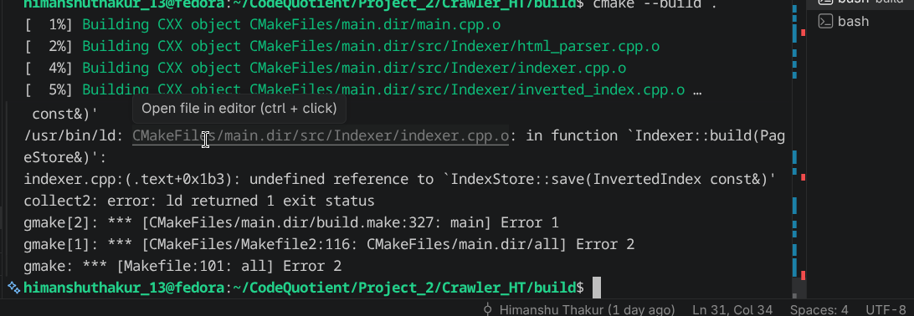
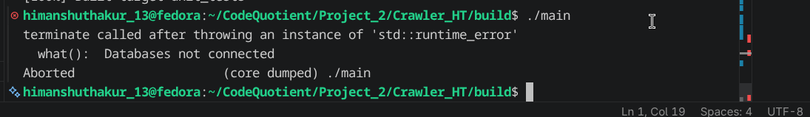
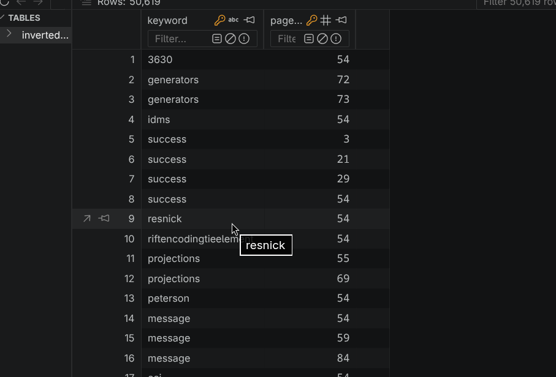
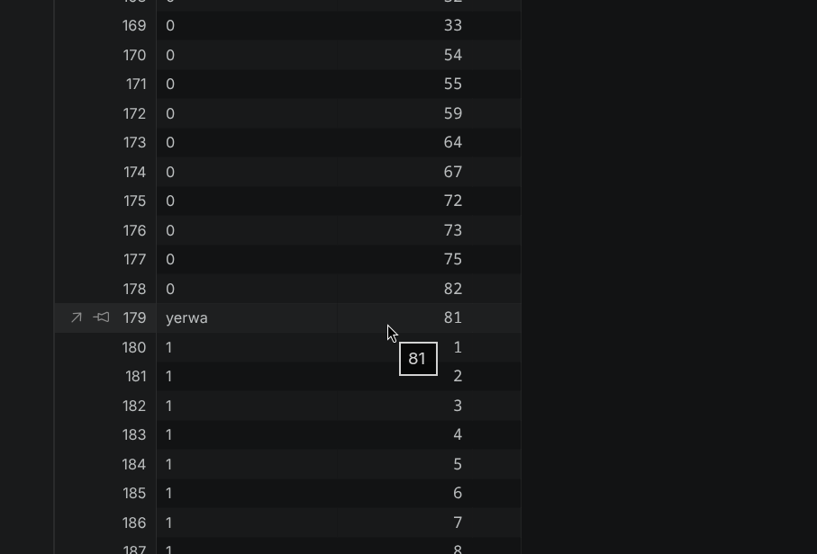

# Build Log

## Date: 28/07/2026

---

## Session - 1

### Work Completed

Started improving the **Normalizer**.

Initially, the normalizer only converted every token to lowercase. While this was enough for basic indexing, it was not sufficient for building a useful search index.

### Planned Improvements

The normalizer will gradually support additional text processing steps, including:

- Convert all words to lowercase.
- Remove punctuation at the end of words.
- Remove possessive suffixes.

```text
teacher's

↓

teacher
```

- Handle apostrophes.

Example:

```text
can't

↓

cant
```

(or possibly preserve apostrophes depending on future design decisions.)

- Perform stemming.

Examples:

```text
running → run

played → play
```

- Remove stop words.

Examples:

```text
the
is
a
of
are
```

These words occur very frequently but contribute little to search quality.

---

## Session - 2

### Designing Index Storage

After finishing the initial indexing pipeline, I started working on storing the generated inverted index inside SQLite.

The crawler already uses a `PageStore` class as a wrapper around `SQLiteDB`.

```text
Crawler

↓

PageStore

↓

SQLiteDB
```

I decided to follow the same design for the Indexer.

### New Design

Instead of allowing the Indexer to communicate directly with SQLite, I created an `IndexStore` class.

The new workflow becomes:

```text
Indexer

↓

IndexStore

↓

SQLiteDB
```

This keeps the Indexer independent of the database implementation and follows the same abstraction used by the crawler.

---

### SQLite Refactoring

While implementing `IndexStore`, I noticed that the `SQLiteDB` constructor automatically created the `pages` table.

Since both the crawler and the indexer now require different tables, I refactored the initialization logic.

The constructor no longer creates tables automatically.

Instead, I introduced two explicit functions:

- `create_pages_table()`
- `create_index_table()`

This allows each component to initialize only the tables it requires.

---

## Session - 3

### Linker Error

While integrating the new classes, the project failed to link.



After reviewing the include hierarchy, I corrected the source file includes and successfully resolved the linker error.

---

### Runtime Crash

The linker error was followed by a runtime crash.



### Investigation

The crash indicated that the SQLite database connection had not been initialized correctly.

After debugging, I found that I had forgotten to pass the database filename to the `IndexStore` constructor.

Once the filename parameter was provided, the database connection was established successfully.

---

## Session - 4

### Index Database Was Empty

After fixing the constructor, the program executed successfully.

However, the generated index was not being stored inside the database.

### Investigation

Initially, I suspected that the wrong filename was being passed to the database constructor.

After tracing the initialization process, I discovered a small typo inside the default constructor of `PageStore`.

The default filename was written as:

```cpp
"data.pages.db"
```

instead of

```cpp
"data/pages.db"
```

Because of this single-character mistake, SQLite created a completely different database file, making it appear as if no data had been indexed.

After correcting the path, the indexer began using the correct database.

---

## Session - 5

### Duplicate Index Crash

While testing repeated executions of the indexer, I encountered another issue.

The first build completed successfully.

```text
=== First Build ===

Success
```

Running the build a second time on the same database caused the program to terminate.

```text
=== Second Build ===

Cannot insert value
```

### Root Cause

`IndexStore::save()` attempted to insert every `(keyword, page_id)` pair without checking whether it already existed.

The SQLite table uses:

```text
PRIMARY KEY(keyword, page_id)
```

Therefore, rebuilding the index attempted to insert duplicate rows, causing SQLite to reject the insertion.

Unlike `PageStore::flush()`, the `IndexStore::save()` implementation also lacked transaction handling and exception recovery.

The exception propagated out of `main()` and terminated the entire program.

Result:



---

## Session - 6

### Further Investigation

While debugging the duplicate insertion issue, I discovered several additional problems throughout the indexing pipeline.

These issues require further investigation before the Indexer can support safe incremental rebuilding.

Current observations include:

- Duplicate keyword insertion during repeated indexing.
- Missing transaction handling inside `IndexStore`.
- Lack of rollback when database insertion fails.
- Additional edge cases discovered during repeated execution.

Some of these are shown below.



These issues will be addressed in the next development session.

---

# Summary

## Features Added

- Began extending the Normalizer beyond lowercase conversion.
- Planned support for punctuation removal, possessive handling, stemming, apostrophe handling, and stop-word removal.
- Designed and implemented the `IndexStore` abstraction.
- Refactored `SQLiteDB` table creation into dedicated functions.
- Connected the Indexer to SQLite through `IndexStore`.
- Fixed linker issues during integration.
- Fixed database initialization by passing the correct filename.
- Corrected the default database path (`data/pages.db`).
- Identified duplicate insertion issues during repeated indexing.

## Bugs Found

- Missing database filename caused SQLite connection failure.
- Incorrect default database path created a different database file.
- Rebuilding the index caused duplicate `(keyword, page_id)` insertions.
- `IndexStore::save()` lacked transaction handling and exception recovery.
- Several additional indexing bugs were identified for future work.

