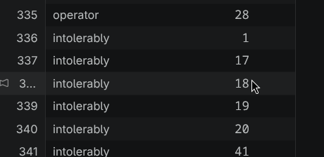
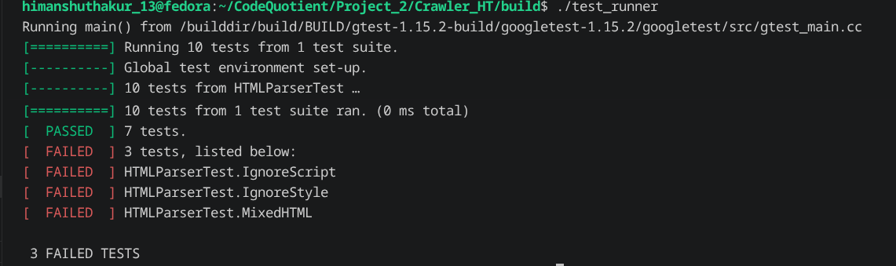
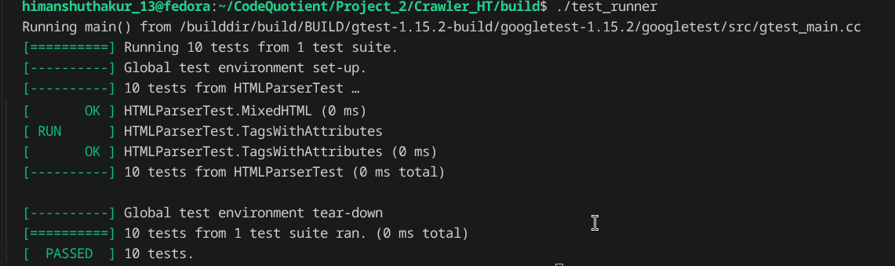
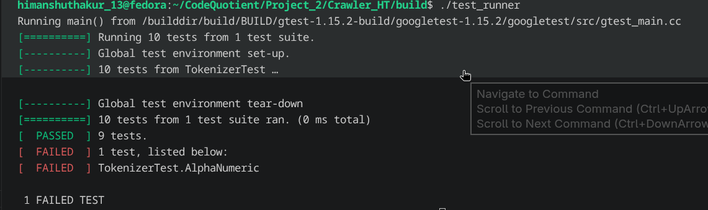
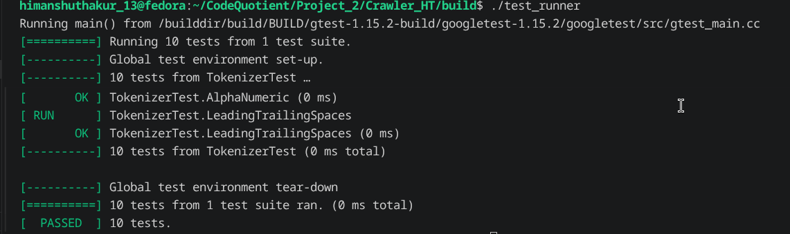
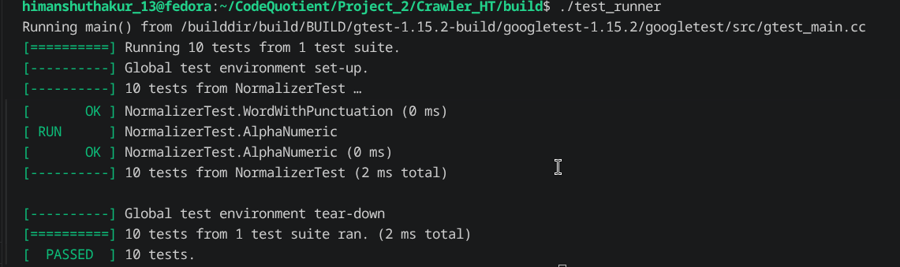

first the issue with the stored keyword they are like single char 

also the second issue is with only number keyword

fixing these two problems by 
not returning word which has less letter than two char
if the word does not contain any alphabet than does not include it

after solving it lets move to testing but first I am going to test the while pipeline from start like from crawler to storing pages and then making index
ok the new test with different url is successful
the result are better then previous 

now next going to move with g-test testing 
first i test the html parser 
here 3 test fails

MixedHTML
IgnoreStyle
IgnoreScript

this is happening because
IgnoreScript

result = ""
Expected = "Hello"

The HTML is:

<body>Hello</body>

An empty string means once the parser entered SCRIPT mode, it never came back to TEXT mode.

IgnoreStyle

result = ""
Expected = "Hello"

Same behavior.

MixedHTML

result = "Demo"
Expected = "Demo Hello World"

It successfully parsed the <title>Demo</title>, then encountered  by html.compare
here it passes all the test cases 

now testing tokenizer failed one test case that is the alphanumeric

ok the problem is that my tokenizer only take alphanumeric character as token not like any symbols 

changing the test case as I only want the toknzier to return word not word with symbols 
after it all the test cases pass

next i test normalizer and it passes all test cases
