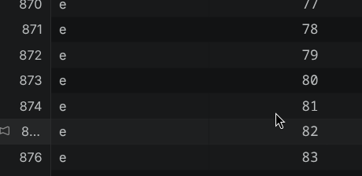
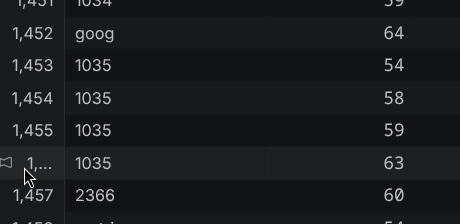

first the issue with the stored keyword they are like single char 

also the second issue is with only number keyword

fixing these two problems by 
not returning word which has less letter than two char
if the word does not contain any alphabet than does not include it
