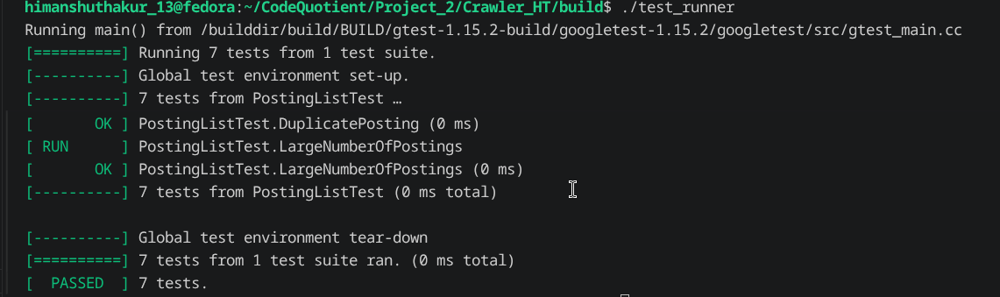
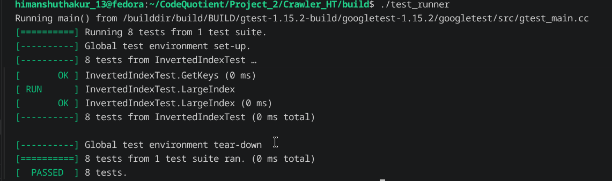

# Build Log

## Date: 29/07/2026

---

## Session - 1

### Work Completed

Started debugging the quality of the generated inverted index.

After inspecting the stored keywords inside the database, I noticed that many indexed words were incorrect.

### Issue 1 – Single Character Keywords

The database contained a large number of single-character keywords.

Example:


Words such as:

```text
a
b
c
x
```

were being indexed even though they provide very little value during searching.

---

### Issue 2 – Numeric Keywords

I also noticed that many indexed terms consisted entirely of numbers.

Example:


These values were typically page numbers, IDs, years, or other numeric values that are not useful for the current search engine.

---

### Solution

Updated the normalizer so that it filters out low-quality tokens before they reach the inverted index.

The new rules are:

- Ignore words whose length is less than two characters.
- Ignore tokens that do not contain at least one alphabetic character.

Examples:

```text
a
1
25
999
_
```

are discarded, while:

```text
crawler
html
cpp17
```

are still indexed because they contain alphabetic characters.

---

## Session - 2

### End-to-End Pipeline Testing

Before writing additional unit tests, I decided to verify the complete pipeline.

The test covered:

```text
Crawler

↓

Fetch Web Pages

↓

Store Pages in SQLite

↓

Load Pages

↓

Indexer

↓

Build Inverted Index

↓

Store Keywords
```

I tested the pipeline using a different seed URL.

The indexing results were significantly cleaner than before because of the new filtering rules.

Result:


The generated index now contains far fewer unnecessary keywords and better represents the page contents.

---

## Session - 3

### HTML Parser Unit Tests

Started executing the Google Test suite for the HTML parser.

Three test cases failed.


The failing tests were:

- `MixedHTML`
- `IgnoreStyle`
- `IgnoreScript`

---

### Investigation

#### IgnoreScript

Output:

```text
Result   = ""

Expected = "Hello"
```

Input HTML:

```html
<script>int x = 10;</script><body>Hello</body>
```

The parser successfully entered `SCRIPT` mode but never returned to `TEXT` mode after the closing `</script>` tag.

---

#### IgnoreStyle

The same issue occurred for style elements.

```text
Result   = ""

Expected = "Hello"
```

The parser remained inside `STYLE` mode until the end of the document.

---

#### MixedHTML

Output:

```text
Result   = "Demo"

Expected = "Demo Hello World"
```

The parser correctly extracted the page title but ignored everything appearing after the `<style>` section.

---

### Root Cause

The helper function `match_tag()` was designed to match opening tags.

For closing tags such as:

```html
</script>

</style>
```

the comparison failed because the function attempted to examine the character following the already matched `>` character.

As a result, the parser never detected the closing tags and remained permanently inside the `SCRIPT` or `STYLE` state.

---

### Fix

Replaced the `match_tag()` calls for:

- `</script>`
- `</style>`

with direct calls to:

```cpp
html.compare(...)
```

This correctly detects the closing tags and allows the parser to transition back to `TEXT` mode.

After the fix, every HTML parser test passed successfully.


---

## Session - 4

### Tokenizer Tests

Next, I executed the Tokenizer test suite.

One test case failed.


The failing test was:

```text
Alphanumeric
```

---

### Investigation

Initially, I thought the tokenizer implementation was incorrect.

After reviewing the tokenizer's intended behavior, I realized that the implementation was actually correct.

The tokenizer is designed to return only words composed of alphanumeric characters after splitting on punctuation and symbols.

The failing unit test expected symbols to remain attached to words, which contradicted the intended design.

---

### Resolution

Updated the test case so that it matched the tokenizer specification.

After correcting the test, every tokenizer test passed successfully.


---

## Session - 5

### Normalizer Tests

Executed the complete Normalizer test suite.

The tests verified:

- Lowercase conversion.
- Punctuation removal.
- Possessive removal.
- Apostrophe handling.
- Stemming.
- Stop-word removal.
- Token filtering.

Result:

All test cases passed successfully.


---

### PostingList Tests

Executed the PostingList unit tests.

Verified:

- Posting insertion.
- Duplicate detection.
- Posting retrieval.

All test cases passed successfully.



---

### InvertedIndex Tests

Finally, executed the InvertedIndex test suite.

Verified:

- Keyword insertion.
- Posting list creation.
- Word lookup.
- Duplicate handling.

All test cases passed successfully.



---

# Summary

## Improvements Made

- Filtered single-character keywords.
- Ignored tokens containing no alphabetic characters.
- Improved the quality of indexed keywords.
- Successfully tested the complete crawler-to-indexer pipeline.
- Fixed HTML parser state transitions for `</script>` and `</style>`.
- Corrected HTML parser closing-tag detection.
- Updated the tokenizer test to match the intended tokenizer behavior.

## Test Results

| Component | Status |
|-----------|--------|
| End-to-End Pipeline | ✅ Passed |
| HTML Parser | ✅ Passed |
| Tokenizer | ✅ Passed |
| Normalizer | ✅ Passed |
| PostingList | ✅ Passed |
| InvertedIndex | ✅ Passed |