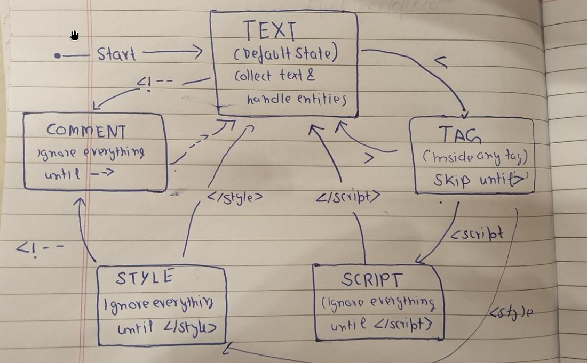

# Design Journal

---

# Section 1 — Specific Bug

## Linker Error

### Compiler Output

```text
undefined reference to ...
```


### Cause

After implementing the complete indexer pipeline, the project failed during linking. The issue was that source files inside `src/Indexer/` were including headers using:

```cpp
#include "indexer.h"
```

instead of

```cpp
#include "Indexer/indexer.h"
```

After correcting the include paths, the project compiled and linked successfully.

---

# Section 2 — Failed Attempt

After implementing the indexer pipeline, I expected that if `build()` completed successfully, then my inverted index must also be correct.

However, I had no way to verify whether words were actually being inserted into my custom `HashMap`. Running the program only showed that the index was built, not what was inside it.

To solve this, I first implemented a `show()` function inside the `HashMap` that prints all stored keys. Then I exposed another `show()` function through `InvertedIndex` so I could inspect the indexed words directly. Later I improved the function by adding a parameter `show(int n)` so only the first *n* entries are displayed, making debugging much easier.

---

# Section 3 — Memory Diagram

## HTML Parser Diagram

**Image:** `parser_diagram.png`



The diagram illustrates:

- Reading HTML character by character
- Removing HTML tags
- Ignoring `<script>` contents
- Ignoring `<style>` contents
- Ignoring HTML comments
- Inserting spaces after tags
- Normalizing whitespace
- Decoding HTML entities
- Removing trailing whitespace
- Producing clean plain text for the tokenizer

---

# Section 4 — Code Reference

| Commit Hash | File |
|--------------|------|
| `676e609` | `src/page_store.cpp` |
| `a5890cd` | `src/Indexer/indexer.cpp` |
| `cf6b349` | `src/Indexer/inverted_index.cpp` |
| `11e9642` | `src/Indexer/posting_list.cpp` |
| `2de94b0` | `src/Indexer/tokenizer.cpp` |
| `6843ca7` | `src/Indexer/html_parser.cpp` |
| `ab478db` | `src/Indexer/html_parser.cpp` |
| `7edb220` | `src/Indexer/html_parser.cpp` |
| `089871c` | `src/crawler.cpp` |
| `ac02b2b` | `src/Indexer/html_parser.cpp` |

---

# Section 5 — Learning Reflection

Today I completed almost the entire indexing pipeline. Earlier I thought the indexer would simply read pages and store words inside a data structure, but while implementing it I realized every stage depends on the previous one.

I first implemented `PageStore::get_all_pages()` so the indexer could load every page from the SQLite database. Then inside `build()`, every page is passed to `index_page()`, where the HTML is converted into plain text using the HTML parser, tokenized into individual words, normalized, and finally inserted into the inverted index.

One thing I found interesting was using my own `HashMap`. Since `HashMap::get()` returns a reference to the value, I could directly write:

```cpp
index.get(word).add_posting(page_id);
```

without checking whether the word already exists. If the key is missing, the `HashMap` creates a new posting list automatically and returns its reference.

While testing, I also realized that just because the program builds successfully does not mean the data inside it is correct. I had no way to see what was stored inside the inverted index, so I added `show()` functions to both the `HashMap` and the `InvertedIndex`. That made debugging much easier because I could actually verify the indexed words instead of assuming everything was working correctly.

Another thing I noticed is that if I call `Indexer::build()` multiple times, duplicate postings might be inserted. I haven't solved that yet, but I have noted it as something to investigate later. This reminded me that designing software is not only about making it work once, but also about thinking about repeated execution and future improvements.