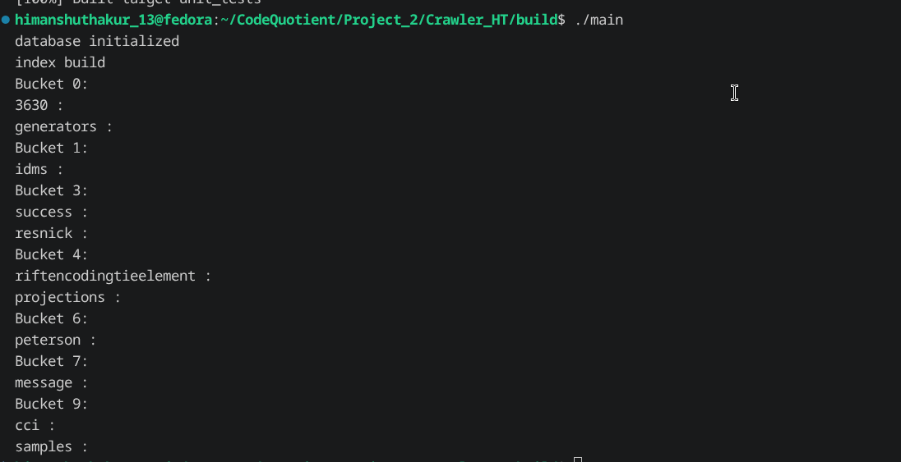

First I write the indexer.cpp in which i implement the get_all_pages function in the Page store i am going to use the page store for getting the pages to store inside the indexer by implementing a get_all_pages function that rely on the sqlite_db file which return a array of pages

Then i use this get_all_pages function in the indexer.cpp to impement the build function which call the index page function in for all pages store in the array 

index function simply take the html from the page call the parser extract_text function and then call the tokenizer to convert it into tokens 
then in a loop it will normalize all the tokens and save it inside the inverted index by calling the add_word function of inverted index 
 
the inverted index add_word function work by calling the get function of the hashmap the get function of the hashmap return a reference of the value of the key-value pair 
there is also a thing if there is not key it inserted a new key and return a reference to value 
in the hashmap the keyvalue pair is the keyword and the postinglist 
the posting list have array of posting struct which contain page_id and have a add funtion which add a posting to the array we call index.get(word).add_posting(page_Id); inside the add_word function of the inverted_index

there also one more thing what I will see it in the future that if i call the build function of the indexer again it can push duplicate value in the hashmap do not know does it actually going to happen or not as hashmap duplicate inserting just overwrite the old value

after it implement the get_index function in the indexer.h since inverted_index is part of the indexer class and is private we can'nt acces it directly so we return a const reference to it so that we can access it function 

now testing it in main i faces another linker error 

fix it,the issue is i need to add Indexer/ to #include "xxx.h" like #include "Indexer/xxx.h"
in the src files

I got a result that index is build but as I check it did n't have the key i suppose which can be incorrect inside it 
think of writing a function which show the entire hashmap of inverted indexer

added a show function in hash map which display the key only not the value as the value postinglist does not have any show function write now 

add the show function to the inverted index and call the show function inside it 

after running the program i get result like this 

I then make more improvement in the show function making it to take a parameter int n so that it shows only the top 10 elements of the hashmap
this is the second result
