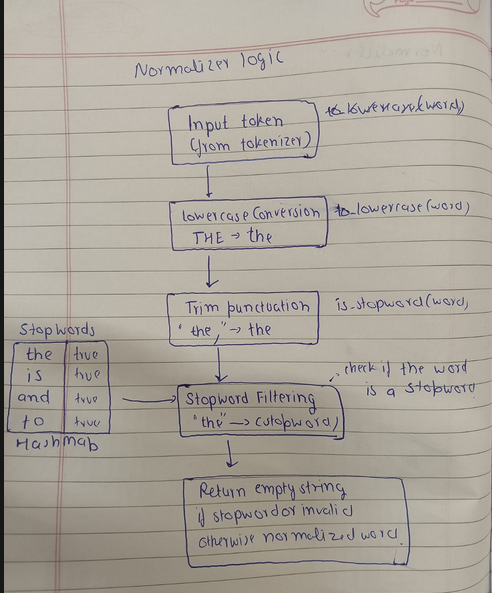

# Design Journal

---

# Section 1 — Specific Bug

## Index Rebuild Crash

### Runtime Output

```text
=== First build ===
First build: OK

=== Second build (same DB, same page, no new pages added) ===
Second build threw: Cannot insert value
```

(See `image-30.png`)

### Cause

After implementing `IndexStore`, the first indexing operation completed successfully, but rebuilding the index using the same database caused the program to terminate.

The problem was inside `IndexStore::save()`. Every `(keyword, page_id)` pair was inserted unconditionally even though the SQLite table uses:

```sql
PRIMARY KEY(keyword, page_id)
```

When the same page was indexed again, SQLite rejected the duplicate insertion and threw an exception. Unlike `PageStore::flush()`, `IndexStore::save()` did not have exception handling or transaction rollback, so the exception propagated to `main()` and terminated the program.

---

# Section 2 — Failed Attempt

Today's work started with improving the normalizer. Initially it only converted tokens to lowercase, but I expanded it to perform punctuation trimming and stop-word removal so the generated index would contain cleaner words.

After that I started storing the inverted index inside SQLite. Since the crawler already uses a `PageStore` wrapper around `SQLiteDB`, I decided to follow the same design and created an `IndexStore` class instead of letting the indexer communicate with SQLite directly.

While integrating it, I first encountered another linker error because of incorrect include paths. After fixing that, the program crashed with a segmentation fault because the `IndexStore` constructor was not receiving the database filename, so no database connection was established.

Once that was fixed, the index still appeared empty. After investigating, I found a one-character typo in the default filename inside `PageStore`:

```cpp
PageStore(const std::string& filename = "data.pages.db");
```

instead of

```cpp
PageStore(const std::string& filename = "data/pages.db");
```

After correcting the path, indexing worked correctly.

While testing repeated builds, I discovered a more important design issue. Running the indexer twice against the same database caused duplicate `(keyword, page_id)` insertions, which violated the table's primary key constraint and crashed the program. I have not fixed this yet because I first want to decide whether the indexer should clear the table before rebuilding or support incremental indexing.

---

# Section 3 — Memory Diagram

## Normalizer Diagram



The diagram illustrates the sequence of transformations performed by the `Normalizer` before a token is inserted into the inverted index.

Pipeline:

```
Raw Token
    │
    ▼
Convert to lowercase
    │
    ▼
Trim trailing punctuation
    │
    ▼
Remove possessive suffix
(teacher's → teacher)
    │
    ▼
Handle apostrophes
(can't → cant)
    │
    ▼
Stop-word filtering
(the, is, a, of, are, ...)
    │
    ▼
Normalized Token
    │
    ▼
Insert into InvertedIndex
```

This normalization step ensures that different forms of the same word are stored consistently in the inverted index, reducing duplicate entries and improving search quality.

# Section 4 — Code Reference

| Commit Hash | File | Description |
|--------------|------|-------------|
| `c56d76a` | `src/Indexer/normalizer.cpp` | Improved normalization with punctuation trimming and stop-word removal. |
| `cdd0f95` | `src/sqlite_db.cpp` | Refactored table creation out of the SQLite constructor. |
| `c22a3d8` | `src/sqlite_db.cpp` | Added `insert_index()` and `clear_index_table()` functions. |
| `11d3f16` | `src/Indexer/index_store.cpp` | Implemented `IndexStore` for saving the inverted index into SQLite. |

---

# Section 5 — Learning Reflection

Today I realized that building the index is only half of the problem. The second part is deciding how the index should be stored and updated. Since I already had a `PageStore` class for the crawler, I decided to keep the same architecture by creating an `IndexStore` instead of letting the indexer access `SQLiteDB` directly. This keeps the responsibilities separated and makes the design more consistent.

While implementing the normalizer, I also understood that lowercasing alone is not enough. Search quality improves when punctuation is removed and common stop words are filtered before indexing. There are still more improvements left, like stemming and better handling of apostrophes, but the normalization stage is becoming much closer to what a real search engine uses.

The biggest thing I learned today came from testing the program multiple times instead of only checking the first successful run. The first build worked perfectly, but the second build crashed because duplicate `(keyword, page_id)` pairs were inserted into the database. That made me realize that software should not only work once—it should also behave correctly when executed repeatedly. Now I need to think about whether rebuilding the index should clear the existing database, update existing entries, or perform incremental indexing. Designing that behavior is just as important as writing the code itself.

While debugging, I also found several additional issues that are not directly related to today's implementation. Instead of fixing everything immediately, I documented them so I can address them systematically in the next development session.